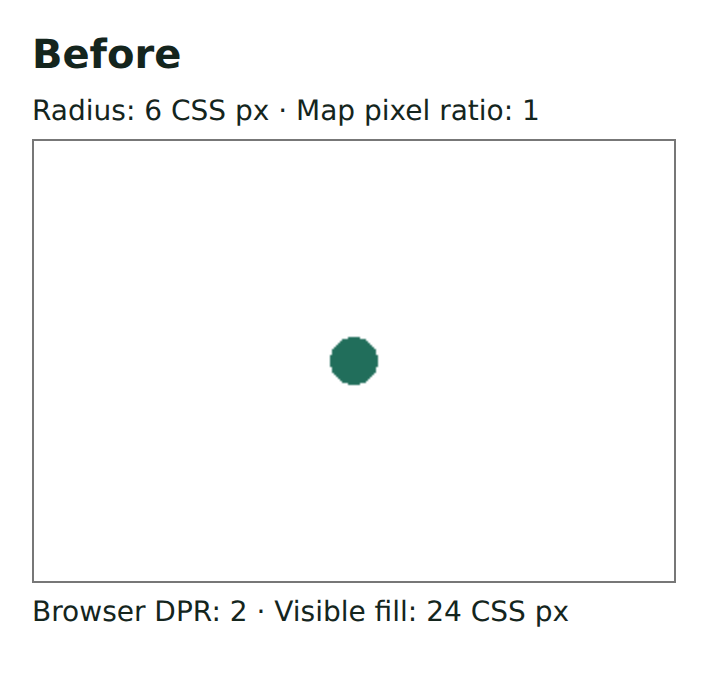
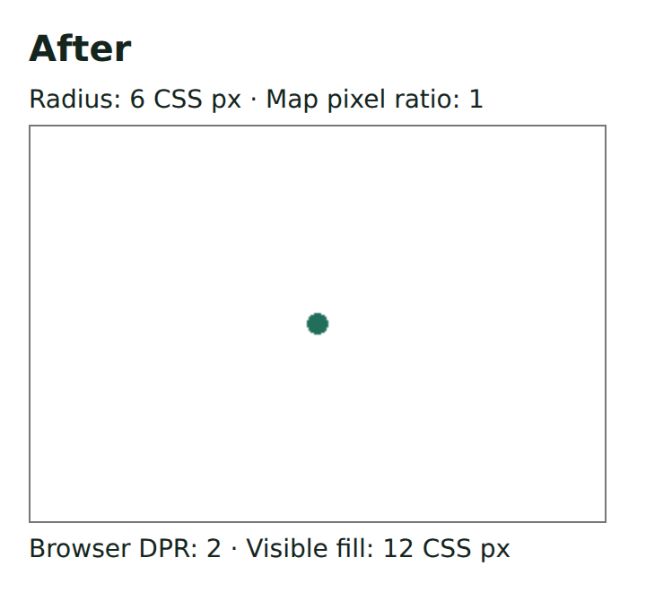

# Issue #25 regression inventory

Integration record for issues #15 through #20, #22, and #25, dated 2026-09-28. The checkpoints preserve the testing foundation, consumer reliability corrections, terrain/camera ownership, and drawing ownership.

`browser` means [tests/browser/main.ts](../tests/browser/main.ts), registered in the Node-safe [case catalog](../tests/browser/catalog.ts). Browser case modules live under `tests/browser/`. Other filenames are under `tests/`. Each audit case below is covered by an executable regression; supporting module tests complement the packaged workflows.

| Audit ID | Implemented regression coverage |
| --- | --- |
| 01 | browser: Reserved feature IDs remain selectable without inherited state |
| 02 | browser: Preparation failures preserve construction and update publication and release the viewport |
| 03 | drawing.test.ts: A failing drawing observer cannot block another observer or submission cleanup; Throwing session listeners do not block preview updates or accepted submission cleanup |
| 04 | drawing.test.ts: A rejected submission cannot clear a newer request started in its notification; An accepted submission cannot clear a newer request started in its notification |
| 05 | browser: A mutating style callback cannot change accepted or rendered feature data |
| 06 | browser: Removing an entity from preparation leaves accepted data and rendered output absent |
| 07 | browser: An initial GeoJSON worker-load rejection recovers with the latest accepted features; Renderer rejection preserves removals and never restores an older update; feature-publication.test.ts: retry replaces a failed initial source with the latest accepted snapshot |
| 08 | browser: Removing and reinserting an airborne ID does not restore its selection |
| 09 | browser: Destroying from a restoration diagnostic stops callbacks and resource creation |
| 10 | drawing.test.ts: Editing properties with BigInt and cycles retains them through history and acceptance |
| 11 | drawing.test.ts: Drawing snapshots coordinates at every point mutation |
| 12 | drawing.test.ts: History keeps only the last 100 completed changes, including gestures and redo; Ordinary edits independently retain only the last 100 draft actions |
| 13 | browser: Inspector label editing preserves Tab and the first real Finish click; Inspector rectangle fields retain consecutive native edits and undo history; Inspector resumes updates after window blur or lost pointer capture |
| 14 | browser: Deleting the focused final vertex keeps keyboard undo reachable |
| 15 | browser: Hover content follows the current feature and survives unrelated removal |
| 16 | browser: Replacing a registered icon updates the map and an open picker |
| 17 | browser: A failed custom picker choice keeps the other choice and keyboard selection usable |
| 18 | drawing.test.ts: Small circle areas use the stable spherical result |
| 19 | browser: A ready camera does not hide unavailable ground attachment terrain; entities.test.ts: unknown ground attachment reports unavailable independent of its camera; sensor-camera-coverage.test.ts: confirmed unavailability takes precedence over a pending camera in either attachment order |
| 20 | entities.test.ts: a public custom sampler keeps a large draped ground area compact; ground zones sample hills inside their boundary and withhold incomplete terrain |
| 21 | browser: One failed terrain region does not settle another pending camera; Unrelated terrain failure preserves the displayed mask of a pending replacement; sensor-camera-coverage.test.ts: a settled missing camera range clears only its output while another range is pending |
| 22 | browser: A 50 km camera at latitude 46 settles with bounded raw terrain loading; elevation-sampler.test.ts: concurrent camera patches converge with bounded downloads (zoom 12 / adaptive); missing pixels do not prevent valid terrain reloading after tile eviction |
| 23 | browser: Airborne shader creation recovers through retryUpdates |
| 24 | sensor-camera-coverage.test.ts: camera computation failure clears obsolete output and retry can recover; browser: A displayed camera failure removes only its coverage and retry uses current inputs |
| 25 | browser: A failed airborne style update retains its last complete display; entity-scene.test.ts: a failed entity style retains the last complete placement |
| 26 | browser: A real click selects a visible camera face clipped by the view; entity-layer.test.ts: picks the visible part of a face whose third vertex crosses the near plane |
| 27 | browser: Mutating object basemaps does not change accepted configuration or style |
| 28 | browser: Arrow editing, basemap replacement, failure, cancellation and retry keep shaft and head coherent |
| 29 | browser: Point above a ground area wins the click and picker-free selection |
| 30 | browser: Icon registration isolates an unrelated failing style callback |
| 31 | drawing.test.ts: Replacement drafts retain their own interaction release |
| 32 | drawing.test.ts: A draft opened by accepted datachange survives the prior submission |
| 33 | browser: Undo during a real vertex drag leaves later edits individually undoable; drawing.test.ts: Undo during a gesture settles that gesture before later edits |
| 34 | drawing.test.ts: Edited geometry drops an imported bounding box that no longer contains it |
| 35 | browser: Custom DEM shifts agree with the installed renderer on both sides of zero |
| 36 | browser: TileJSON Terrarium metadata decodes flat ground in raw and displayed terrain; Raw terrain and the installed renderer agree on nonzero TMS tile templates |
| 37 | browser: Raw terrain and the installed renderer agree on nonzero TMS tile templates; elevation-sampler.test.ts: raw URL templates resolve quadkey, prefix, and projected bounds |
| 38 | sensor-camera-coverage.test.ts: camera completes from exactly prepared coverage at 179.999,46; gpu-camera-terrain.test.ts: camera samples use bounded longitudes across the date line |
| 39 | sensor-camera-coverage.test.ts: camera completes from exactly prepared coverage at 6,46; gpu-camera-terrain.test.ts: patch preparation bounds include every sampled latitude at 46 degrees |
| 40 | browser: A null GPU synchronization result reports failure and recovers on retry |

Additional integration journeys now cover coherent arrow editing/publication/restoration, obsolete camera preparation across movement and kind changes, and exaggeration/picking with completed output. Browser cases run independently through the #30 manifest against the packed package. Controlled failure injection remains limited to existing dependency interfaces; input-sensitive cases use browser input. Window blur is explicitly injected after a native pointer press; pointer capture loss uses browser capture/release and native movement.

Environment limits: desktop Chromium with software WebGL does not establish physical-GPU, other-browser, touch, or long-session production memory guarantees.

## Review regressions, 2026-10-15

The codebase review added focused regressions and packed-consumer journeys for nine further defects:

- [Snapshot cases](../tests/browser/snapshots-review.browser.ts) cover exact retained-value validation, atomic model-setting validation, and shared-memory isolation through reads, callbacks and drawing. [Snapshot module tests](../tests/snapshots.test.ts) exercise cycles, aliases and buffer views.
- [Drawing cases](../tests/browser/drawing-review.browser.ts) cover changes during edit opening, nested teardown with a working replacement editor, application Undo while idle, and draft/history shortcut ownership.
- [Rendering cases](../tests/browser/rendering-review.browser.ts) cover CSS sizes across canvas ratios, invisible hits after draw failure, and model recovery after cumulative allocation rejection. [Ground-area coverage](../tests/browser/ground-area-review.browser.ts) uses real 256-pixel raster decoding at fixed zoom 12 beyond the 512-tile cache, checks visible picking, and observes five quiet seconds. [Sampler tests](../tests/elevation-sampler.test.ts) include competing 100 km circles, missing data, retry and requirement changes.

The marker comparison uses the same packed-consumer fixture with browser DPR 2, map pixel ratio 1 and a requested radius of 6 CSS pixels. The visible fill changes from 24 to 12 CSS pixels.

| Before | After |
| --- | --- |
|  |  |
